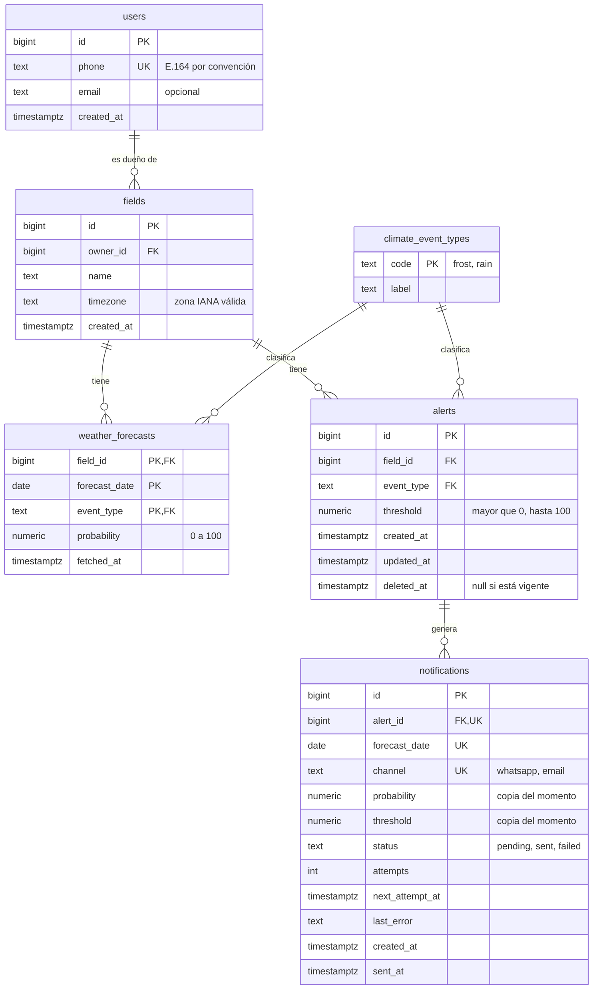
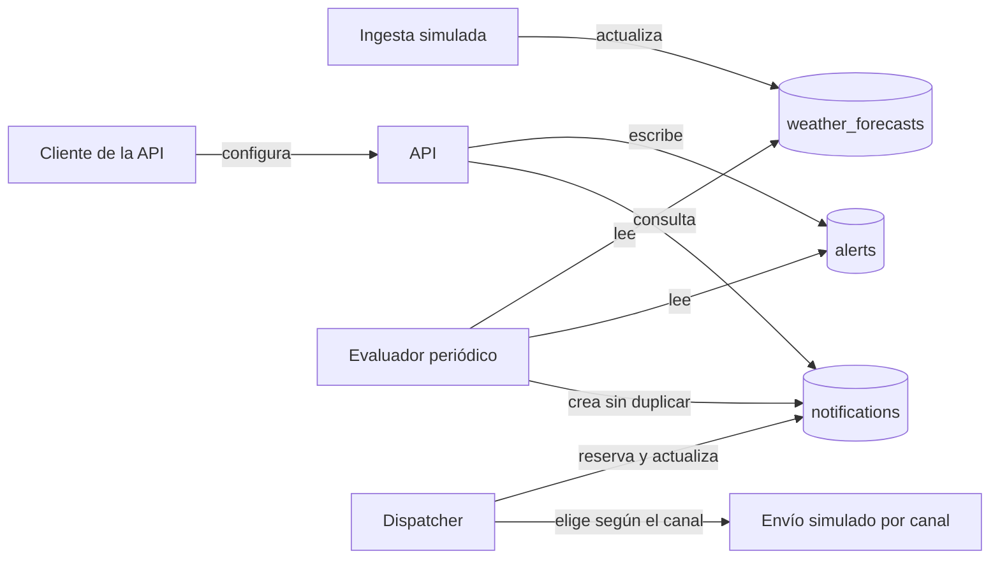
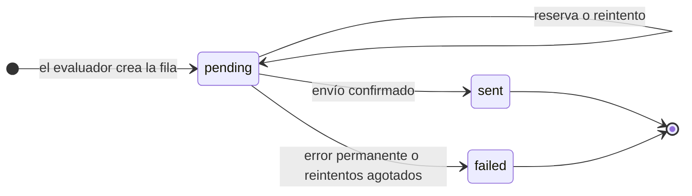
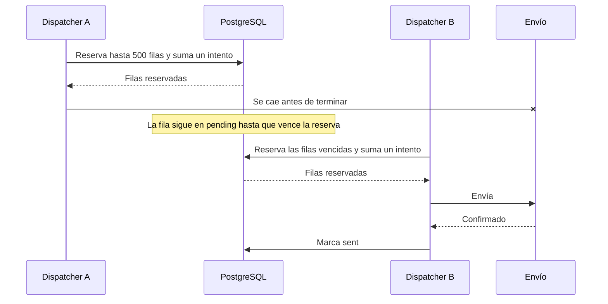
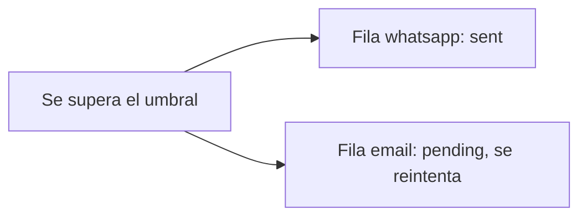

# Modelo de datos

El modelo tiene seis tablas. Un usuario es dueño de varios campos y configura alertas sobre ellos. Cada alerta genera, como máximo, una notificación por fecha pronosticada y canal. Cada notificación es también el registro de su entrega en ese canal.

Las reglas críticas viven en la base de datos, de modo que se cumplen aunque haya varios workers o un proceso falle a mitad de camino. El porqué de cada elección está en [Decisiones.md](Decisiones.md).

## Vista general



| Tabla | Qué guarda | A quién pertenece |
|-------|------------|-------------------|
| `users` | Quién recibe las notificaciones | Agrobot (simulado) |
| `fields` | Campos y su zona horaria | Agrobot (simulado) |
| `weather_forecasts` | Probabilidad por campo, día y evento | Ingesta de Agrobot (simulada) |
| `climate_event_types` | Catálogo de eventos | Compartida |
| `alerts` | Evento y umbral elegidos por el usuario | Este sistema |
| `notifications` | Cada superación del umbral y su entrega | Este sistema |

## Cómo circulan los datos



El evaluador trabaja dentro de PostgreSQL con una sola sentencia por lote: ninguna fila pasa por Python. El dispatcher solo trae a memoria el lote que está enviando.

## Ciclo de vida de una notificación



La transición de `pending` a `pending` cubre tres casos: se reserva la fila, el envío falla de forma transitoria o vence la reserva.

"En curso" no es un estado guardado. Reservar una fila es mover `next_attempt_at` hacia el futuro: mientras esa fecha no llegue, ningún dispatcher la ve. Si el proceso cae, la fila vuelve a estar disponible sin necesidad de un proceso de recuperación.

### Qué pasa si un dispatcher se cae



Si la caída ocurre después de enviar y antes de registrarlo, el mensaje puede salir dos veces. La entrega es **al menos una vez**.

### Canales

El evaluador crea una fila por cada canal habilitado. Como cada fila tiene su propio estado e intentos, un canal puede fallar y reintentarse sin afectar a los demás ni repetir lo ya enviado.



La dirección de cada canal sale de `users`: `phone` para WhatsApp y `email` para correo. Si un usuario no tiene dirección para un canal, la fila termina como `failed`, con el motivo en `last_error`, y queda visible.

## Tablas

### `users`

| Columna | Tipo | Regla |
|---------|------|-------|
| `id` | `BIGINT` identity | Clave primaria |
| `phone` | `TEXT` | Obligatorio y único. E.164 por convención: la base no valida el formato |
| `email` | `TEXT` | Opcional |
| `created_at` | `TIMESTAMPTZ` | Por defecto, `now()` |

### `fields`

| Columna | Tipo | Regla |
|---------|------|-------|
| `id` | `BIGINT` identity | Clave primaria |
| `owner_id` | `BIGINT` | FK a `users`. Indexada |
| `name` | `TEXT` | Obligatorio |
| `timezone` | `TEXT` | Debe ser una zona que PostgreSQL reconozca |
| `created_at` | `TIMESTAMPTZ` | Por defecto, `now()` |

La zona se valida al escribir porque un valor inválido haría fallar la evaluación de todo un lote. No se guardan coordenadas: nada en este ejercicio las usa.

### `climate_event_types`

| Columna | Tipo | Regla |
|---------|------|-------|
| `code` | `TEXT` | Clave primaria, por ejemplo `frost` |
| `label` | `TEXT` | Obligatorio, por ejemplo `Helada` |

### `weather_forecasts`

| Columna | Tipo | Regla |
|---------|------|-------|
| `field_id` | `BIGINT` | Parte de la clave. FK a `fields` con `ON DELETE CASCADE` |
| `forecast_date` | `DATE` | Parte de la clave. Fecha local del campo |
| `event_type` | `TEXT` | Parte de la clave. FK al catálogo |
| `probability` | `NUMERIC(5,2)` | Entre 0 y 100 |
| `fetched_at` | `TIMESTAMPTZ` | Momento en que la ingesta guardó el dato |

La ingesta actualiza la fila existente. No se conserva historial de pronósticos. Por eso borrar un campo borra sus pronósticos: son datos derivados que la ingesta puede volver a traer, a diferencia de las alertas, que están protegidas con `ON DELETE RESTRICT`.

### `alerts`

| Columna | Tipo | Regla |
|---------|------|-------|
| `id` | `BIGINT` identity | Clave primaria |
| `field_id` | `BIGINT` | FK a `fields`. Indexada con `ix_alerts_field_id` |
| `event_type` | `TEXT` | FK al catálogo |
| `threshold` | `NUMERIC(5,2)` | Mayor que 0 y hasta 100 |
| `created_at`, `updated_at` | `TIMESTAMPTZ` | Por defecto, `now()` |
| `deleted_at` | `TIMESTAMPTZ` | `NULL` mientras la alerta esté vigente |

El dueño se obtiene a través del campo. Solo puede haber una alerta vigente por campo y evento. `ix_alerts_field_id` es un índice común, sin filtro, porque el historial de notificaciones incluye las alertas borradas y el índice único parcial no las cubre.

### `notifications`

| Columna | Tipo | Regla |
|---------|------|-------|
| `id` | `BIGINT` identity | Clave primaria |
| `alert_id` | `BIGINT` | FK a `alerts` |
| `forecast_date` | `DATE` | Única junto con `alert_id` y `channel` |
| `channel` | `TEXT` | Canal de esta entrega, por ejemplo `whatsapp` |
| `probability` | `NUMERIC(5,2)` | Valor observado al crear la fila |
| `threshold` | `NUMERIC(5,2)` | Umbral vigente al crear la fila |
| `status` | `TEXT` | `pending`, `sent` o `failed` |
| `attempts` | `INTEGER` | Se incrementa en cada reserva |
| `next_attempt_at` | `TIMESTAMPTZ` | Próximo momento en que la fila puede reservarse |
| `last_error` | `TEXT` | Motivo del último intento fallido. Solo guarda un mensaje del conjunto fijo `DeliveryFailure`, nunca el texto de una excepción |
| `created_at` | `TIMESTAMPTZ` | Por defecto, `now()` |
| `sent_at` | `TIMESTAMPTZ` | Presente solo si `status` es `sent` |

## Reglas que garantiza la base

| Regla | Mecanismo |
|-------|-----------|
| Una sola notificación por alerta, fecha y canal | `UNIQUE (alert_id, forecast_date, channel)` |
| Una alerta vigente por campo y evento | Índice único parcial `WHERE deleted_at IS NULL` |
| Una entrada por campo, día y evento | Clave primaria compuesta |
| Eventos solo del catálogo | Claves foráneas |
| Probabilidades y umbrales válidos | `CHECK` |
| Zonas horarias válidas | `CHECK` |
| Una fila `sent` siempre tiene `sent_at`, y las demás no | `CHECK` |
| No se borra una alerta con historial ni un campo con alertas | `ON DELETE RESTRICT` |
| Búsqueda eficiente de filas por enviar | Índice parcial `(next_attempt_at, id) WHERE status = 'pending'` |

Las zonas horarias y los estados usan `TEXT` con validación en vez de un enum de PostgreSQL. Un enum no permite quitar valores sin recrear el tipo.

## Consultas principales

Se muestran como SQL porque así se leen mejor. En el código se construyen con el lenguaje de expresiones de SQLAlchemy 2.0, y ambas se ejecutaron de esa forma sobre PostgreSQL.

### Evaluación de un lote de alertas

```sql
INSERT INTO notifications (alert_id, forecast_date, channel, probability, threshold)
SELECT a.id, wf.forecast_date, c.channel, wf.probability, a.threshold
FROM alerts a
JOIN fields f ON f.id = a.field_id
JOIN weather_forecasts wf
  ON wf.field_id = a.field_id AND wf.event_type = a.event_type
CROSS JOIN unnest(:channels) AS c(channel)
WHERE a.deleted_at IS NULL
  AND a.id > :after_id AND a.id <= :up_to_id
  AND wf.forecast_date >= (now() AT TIME ZONE f.timezone)::date
  AND wf.probability >= a.threshold
ORDER BY a.id, wf.forecast_date, c.channel
ON CONFLICT (alert_id, forecast_date, channel) DO NOTHING;
```

### Reserva de un lote para enviar

```sql
UPDATE notifications
SET attempts = notifications.attempts + 1,
    next_attempt_at = now() + :lease_interval
FROM alerts a, fields f, users u
WHERE notifications.id = ANY (ARRAY(
        SELECT id
        FROM notifications
        WHERE status = 'pending' AND next_attempt_at <= now()
        ORDER BY next_attempt_at, id
        LIMIT :batch_size
        FOR UPDATE SKIP LOCKED
      ))
  AND a.id = notifications.alert_id
  AND f.id = a.field_id
  AND u.id = f.owner_id
RETURNING notifications.id, notifications.forecast_date, notifications.channel,
          notifications.probability, notifications.threshold, notifications.attempts,
          a.event_type, f.name AS field_name, u.phone, u.email;
```

Los ids se eligen dentro de `ARRAY(...)` porque PostgreSQL lo evalúa una sola vez, como un InitPlan, y después actualiza por clave primaria. Con un `IN (subconsulta)` simple, la subconsulta se puede volver a evaluar y reservar más filas que las que indica `LIMIT`.

## Qué se comprobó

El esquema lo crea la migración `migrations/versions/0001_initial_schema.py`. Estos comportamientos se verifican con la suite de tests sobre PostgreSQL 17 real.

| Área | Comportamiento verificado |
|------|---------------------------|
| Umbral | Un valor igual al umbral notifica, y uno apenas menor no |
| Duplicados | Repetir la corrida no crea filas nuevas |
| Cambios de pronóstico | Una suba solo notifica fechas nuevas y no altera la copia guardada |
| Zona horaria | Una fecha ya pasada en un campo sigue vigente en otro |
| Lotes | Una corrida solo afecta a las alertas de su rango |
| Borrado | Una alerta borrada deja de evaluarse, conserva su fila y libera el lugar para crear otra |
| Reserva | Respeta el tamaño de lote, oculta las filas reservadas y las recupera al vencer |
| Estados finales | Una fila `sent` no vuelve a reservarse |
| Datos inválidos | Se rechazan zonas, umbrales, probabilidades, eventos y estados inválidos |
| Borrados físicos | Se rechaza borrar una alerta con historial o un campo con alertas |
| Canales | Hay una fila por canal, un canal enviado no bloquea al otro, y habilitar un canal después solo agrega ese canal |
| Direcciones | La reserva devuelve la dirección de cada usuario y expone cuando falta |

## Límites conocidos

- La tabla `notifications` crece sin límite. El archivado queda fuera de alcance.
- Borrar y volver a crear una alerta genera un identificador nuevo, por lo que puede notificar otra vez las mismas fechas.
- Cambiar un umbral no repite las fechas ya notificadas.
- Las notificaciones ya creadas se entregan aunque la alerta se borre después.
- Habilitar un canal nuevo notifica por ese canal las fechas futuras que sigan por encima del umbral.
